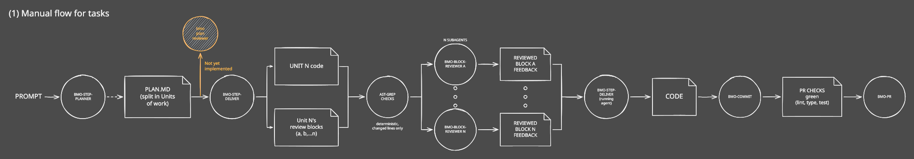
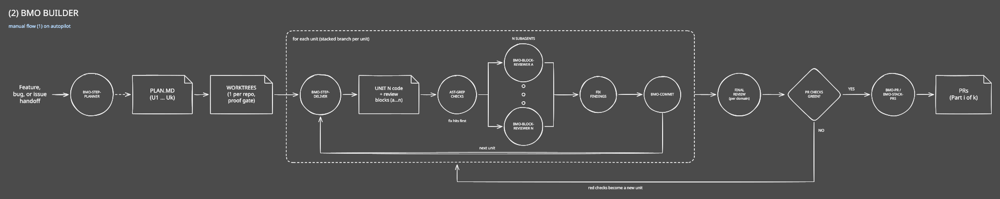
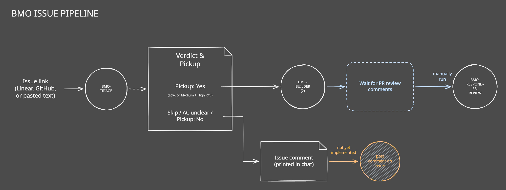
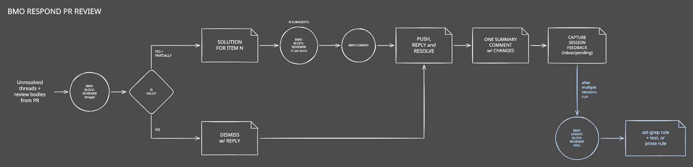

# Agent skillset

Portable agent skills for planning vertical slices, shipping verified code, running deterministic + two-pass domain code reviews, opening concise merge-risk-scored PR stacks, and closing review loops.

```bash
npx github:lucasfvera/agent-skillset
```

Copies every `bmo-*` skill into `~/.cursor/skills/` (or `$BMO_SKILLS_DIR` when set) and installs the pre-PR checks hook (`hooks/pr-checks.py`) into `~/.cursor/hooks/`. Environments without shell hooks enforce the same pre-PR checks directly via [`hooks/pr-checks.md`](hooks/pr-checks.md) inside `/bmo-builder` and `/bmo-pr`.

## Manual Workflow



The original flow from which these skills evolved: running one skill at a time with human checkpoints before composing them into automated pipelines.

Diagram sources live in [`docs/diagrams/`](docs/diagrams/): open a `.excalidraw` file at excalidraw.com to edit it, then export it as SVG with dark mode on over the matching `.svg`.

## Skills

| Skill | When to use it |
|-------|----------------|
| `/bmo-block-reviewer` | Deterministic `ast-grep` pre-scan (`checks/run-checks.py`, auto-detected stack profiles, diff-line ratchet) + two-pass findings-first AI review: Pass 1 (`[issue]`) catches correctness, contract, security, performance, and false-test defects; Pass 2 (`[style]`) checks conventions across domain catalogs (`core`, `frontend`, `backend`, `database`, `testing`). |
| `/bmo-commit` | Creates a git commit strictly from staged changes without editing files or running formatters, matching the repository's commit style. |
| `/bmo-document-html` | Produces standalone, graphics-first technical documentation as a self-contained HTML page with diagrams, semantic layout, and light/dark styling. |
| `/bmo-git-stack-update-refs-push` | Rebases a local branch stack with `git rebase --update-refs`, aligns upstream tracking, and publishes rewritten tips with `--force-with-lease`. |
| `/bmo-integration-tests` | Adds or extends service integration tests against real databases, HTTP/gRPC/RPC transports, and message brokers using the smallest real stack that proves the production boundary. |
| `/bmo-merge-conflicts` | Analyzes git rebase merge conflicts side-by-side (suggestions only by default; resolves files only on explicit ask). |
| `/bmo-merge-risk` | Assesses PR merge risk (`low` / `medium` / `high`) across alignment, impact, verification, rollback cost, and error detection; runs standalone or as a subagent inside `/bmo-pr`. |
| `/bmo-pr` | Opens or updates concise GitHub PRs (~100–200 LOC production soft ceiling, co-located tests) with green pre-PR checks (`hooks/pr-checks.md`), optional diff sketches, before/after evidence, and an embedded `/bmo-merge-risk` subagent report. |
| `/bmo-stack-prs` | Infers stacked branch order from git history, pushes out-of-sync stack heads, and opens stacked GitHub PRs (`Part i of k — depends on #prev`) with per-slice `/bmo-merge-risk` reports. |
| `/bmo-step-deliver` | Delivers scoped ~100–200 LOC vertical slices (with tests) one unit at a time, running narrow verification and emitting a structured review digest before pausing for `continue`. |
| `/bmo-step-planner` | Authors a sliced markdown plan (`U1`, `U2`, …) with ~100–200 LOC vertical units, co-located tests, backing docs, boundary failure modes, and rollback seams before writing code. |
| `/bmo-sync-repo-documentation` | Brings repository documentation (`README`, `docs/`, `AGENTS.md`, `CLAUDE.md`, `GEMINI.md`, rules, skills) back in sync with real scripts, env samples, paths, and CI. |
| `/bmo-teach` | Scaffolds an offline, hands-on learning repository calibrated to your starting point across sprint, portfolio, and TDD kata tracks. |
| `/bmo-tone` | Enforces direct, zero-fluff engineering prose when ghostwriting PRs/comments/docs or replying in chat. |
| `/bmo-triage` | Scores an issue (Linear, GitHub Issues, or pasted text) on complexity, Kano user value, importance, ROI, and automated pickup readiness. |
| `/bmo-update-block-reviewer-skill` | Distills pending PR review captures from `inbox/pending/` via an escalation ladder (portable `ast-grep` rule + proof test first, prose-only last) into domain- and tier-classified rules tracked in `ledger.md`. |

## Workflows

### `/bmo-builder`



| When to use it |
|----------------|
| End-to-end build when you already know the work: authors a vertical-sliced plan (`U1..Uk`), creates isolated worktrees per repo with stacked unit branches by default, delivers each unit with parallel 2-pass block review and commits, runs parallel domain-scoped final review + pre-PR checks (`hooks/pr-checks.md`), and opens stacked PRs. |

### `/bmo-issue-pipeline`



| When to use it |
|----------------|
| Hands-off pickup of an issue (Linear key/URL, GitHub Issue, or tracker text): runs `/bmo-triage` first, checks Gate 1 (`Proceed` + `Pickup: Yes`), and hands off to `/bmo-builder` to ship the PR(s). Stops cleanly on `Skip`, unclear acceptance criteria, or `Pickup: No`. |

### `/bmo-respond-pr-review`



| When to use it |
|----------------|
| Closes the human PR review loop end to end: triages inline threads and top-level review bodies, implements fixes locally, runs one 2-pass `bmo-block-reviewer` subagent per code-changing review item before push, replies and resolves threads on GitHub without duplicate top-level comments, and captures raw feedback into `inbox/pending/`. |
