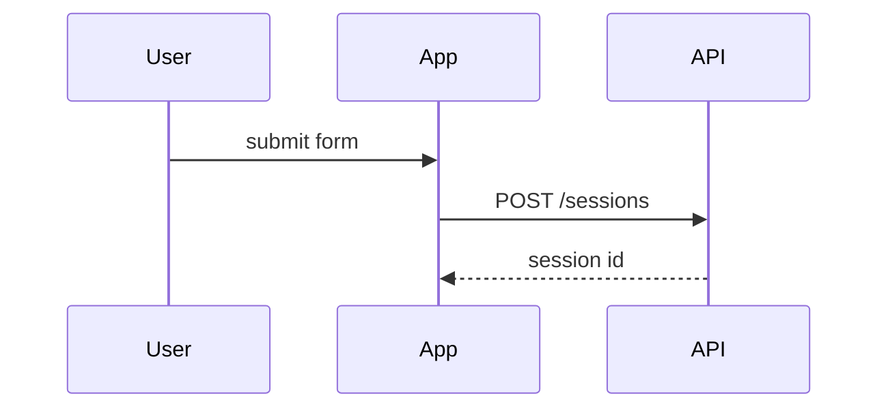

# Compact visual sketches for PR bodies

<!-- Credits: adapted from Matt Pocock's `pr` skill (https://github.com/mattpocock/skills/blob/main/skills/engineering/pr/SKILL.md) and Dex Horthy / Humanlayer's `show-me` skill (https://github.com/humanlayer/skills/blob/main/plugins/show-me/skills/show-me/SKILL.md). -->

Load only when the 2–3 sentence opening in [`SKILL.md`](../SKILL.md) hides a change in control flow, UI hierarchy, module layout, or cross-service interaction. Pick **one** sketch—the smallest view that shows the point—and include only nodes touched or needed for context.

## Diff tree (when surrounding shape already exists)

Control flow or call stack:

```diff
 submitForm
   createSession
     persistPrompt
+    validateQuota
     launchWorker
```

Component hierarchy:

```diff
 <AccountPage>
   <ProfileHeader />
   <SettingsPanel>
+    <DeleteAccountDialog />
```

Directory layout:

```diff
 src/
 ├── auth/
-└── transport.ts
+└── transport/
+    ├── client.ts     # retries and timeouts
+    └── stream.ts     # server-sent events
```

## Plain tree or pseudocode (when mostly new)

```text
on(save)
  if content unchanged -> return cached
  write content
  invalidate cache
```

## Mermaid sequence (when interaction crosses services or actors)



**Done:** At most one compact sketch (≤ 12 lines) sits right below the opening sentences, or no sketch is added because prose already states the change.
